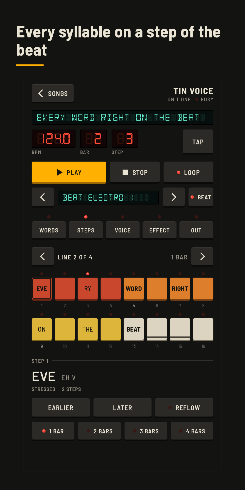
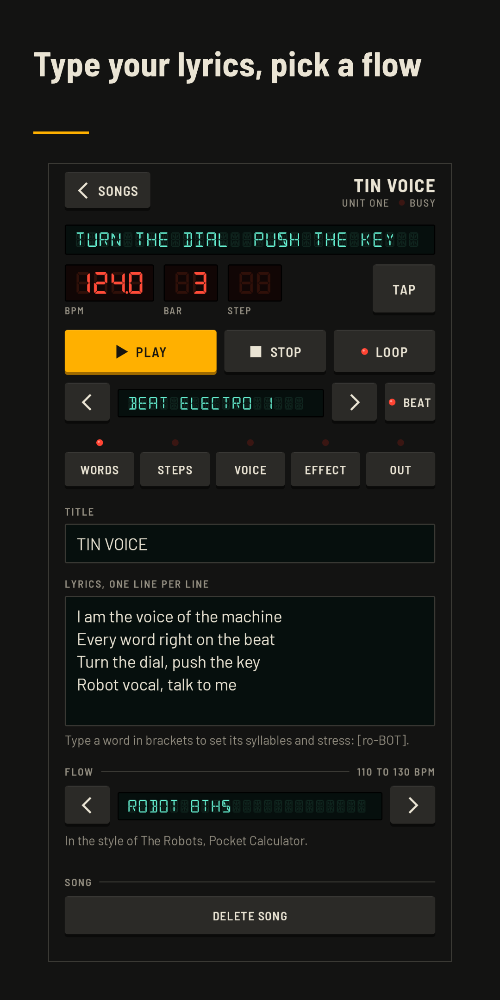
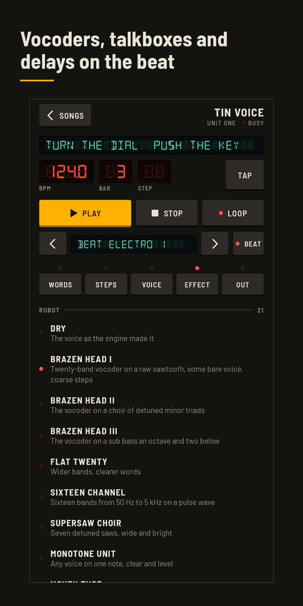
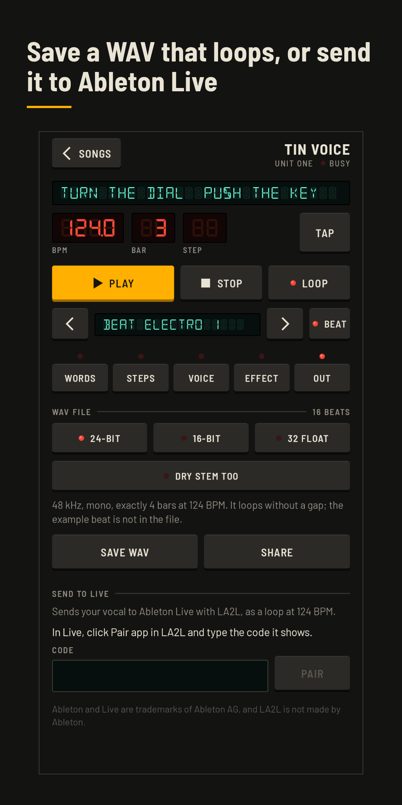

# Robot Vocal for Android

Type your lyrics, pick a tempo and a robot voice, and Robot Vocal raps them
with every syllable on a step of the beat. Check the timing against an example
beat, move syllables around on a step grid, and save the vocal as a WAV file
that loops, or send it straight into Ableton Live with
[LA2L](https://github.com/lloydstellar/Lloyds-app2live). The example beats are
for listening only and never end up in a file.

Made by [Lloyd Stellar](https://lloydstellar.nl), an electro producer from
Hilversum. No account, no ads, no tracking; the app only goes online when you
send to Live.

<p>




</p>

## What it does

1. **Words.** Lyrics become syllables with stress: CMUdict for 126,052 words, the NRL rules of 1976 for the rest, numbers and initialisms read the way rappers say them. A word in brackets sets its own syllables: `[ro-BOT]`.
2. **Flow.** Eleven flows put the syllables in slots, from robot 8ths and one word per beat to triplets and half-time trap. The placement weighs where rappers put stressed syllables (the MCFlow corpus), rests at punctuation and the rhyme on beat four. Every syllable can be moved by hand.
3. **On the beat.** The vowel of every syllable starts exactly on its step; the consonants before it start a little earlier, so the word is heard on the beat. Frames are computed from the absolute position, so nothing drifts.
4. **Voices.** 49 voices from six engines: our own Klatt formant synthesizer (five characters, from clean to a 1970s allophone chip); five home computer voices of our own, made the way the software speech of 1982 was made (three tones restarted on every pulse, 4-bit); eighteen retro voices ported from [whackintalk](https://github.com/joehahndev/whackintalk) (talking computers of the mid-1980s, seven of which sing a tune over your notes); Flite's kal diphone voice; SPELLER, kal encoded for the speech chip of a 1978 talking spelling toy and spoken by an emulation of that chip ported from MAME; and nineteen voices of eSpeak NG. All but eSpeak NG take our durations directly; eSpeak NG is rendered per word and only the middle of each vowel is stretched.
5. **Effects.** Twenty robot effects (vocoders, talkboxes, a speech chip at 8 kHz, ring modulation and more), movement (ensemble, filter sweeps, beat repeat) and space (delays on the beat, an echo throw on line ends, plates).
6. **Out.** WAV at 48 kHz, mono or (with a stereo effect) stereo, 24-bit, 16-bit or 32-bit float, exactly a whole number of bars with an `acid` tempo chunk, plus a dry stem if you want. Send to Live puts it on a new track, warped to the Set's tempo.

## Build

You need JDK 21 and the Android SDK (compile SDK 37) with NDK `30.0.16248370` and CMake `3.22.1`. Android Studio has all of them.

```
./gradlew :app:testDebugUnitTest          # unit tests: text, flow, timing, voices, effects
./gradlew :app:assembleDebug              # debug build (package nl.lloydstellar.robotvocal.debug)
adb install -r app/build/outputs/apk/debug/app-debug.apk
```

The app runs on Android 11 and up (`minSdk 30`). The native libraries are built for arm64-v8a and x86_64 and aligned for 16 KB pages.

Release builds are signed with a key in `signing/`, which is not in this
repository. Without it `assembleRelease` still builds, unsigned.

To try Send to Live without Ableton, run LA2L's test receiver and point a
debug build at it:

```
npx @lloydstellar/la2l test-receiver --local --port 41234
adb reverse tcp:41234 tcp:41234
./gradlew :app:assembleDebug -Pla2lServer=http://127.0.0.1:41234/api
```

## Tests

The unit tests run on the JVM against the real lexicon: syllables and stress,
numbers, the placement of every flow, the grid maths against LA2L's frame
formula, vowel formants measured with LPC, the hiss of s and sh, notes in tune
to a few cents, the 16 levels of a 4-bit voice, every effect
for range, silence and exact repeats, and delays that land on the beat to the
sample. Their WAV output goes to `tools/audio/` (not in git) to check by ear.

## What is where

| Path | What |
|---|---|
| `app/src/main/java/.../text` | normaliser, lexicon, letter-to-sound, syllables, lyrics |
| `app/src/main/java/.../score` | ticks, flow presets, the placement algorithm, the song model |
| `app/src/main/java/.../render` | timing planner (vowel on the beat), arranger, renderer, loop fold |
| `app/src/main/java/.../voice` | the formant, home computer, retro and speech chip engines, Flite, eSpeak NG and the voice list |
| `app/src/main/java/.../dsp` | vocoder, talkbox, speech chip, delays, plates and the other effects |
| `app/src/main/java/.../beats` | the drum synthesizer and the example beats (preview only) |
| `app/src/main/java/.../export` | WAV writer, saving and sharing, Send to Live |
| `app/src/main/java/.../ui` | the front panel: theme, keys, displays and the screens |
| `app/src/main/cpp` | Flite and eSpeak NG sources, and the JNI glue |
| `docs/PLAN.md`, `docs/research` | the plan and the research behind it |
| `tools/` | lexicon packer, icon and store graphics, the Play Store package |

## License

GPL-3.0-or-later, see [LICENSE](LICENSE). The license covers the code, not the
name or the artwork: "Robot Vocal", the app icon and the Lloyd Stellar name
are not part of it. If you publish your own build, give it another name and
icon and a different package name. See [NOTICE](NOTICE), which also lists the
third-party parts and their licenses.
